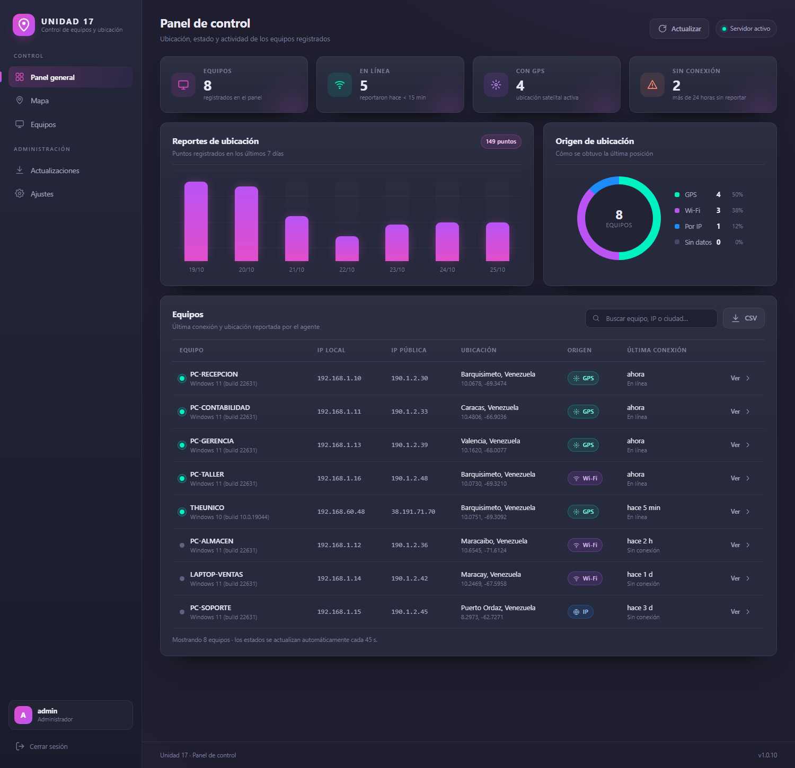

# Unidad 17 · Control de equipos y ubicación · v1.0.10

Panel web de administración + agente de ubicación para Windows. Sabe dónde está
cada equipo, cuándo reportó por última vez y con qué método se obtuvo la
posición: GPS de Windows, triangulación Wi-Fi con Google o respaldo por IP.

> **Diseñado para uso transparente.** El agente se ejecuta con una ventana
> visible y avisa al usuario la primera vez. No incluye ocultamiento, captura de
> pantalla, control remoto ni persistencia encubierta. Úsalo solo en equipos
> propios o con autorización expresa. Lee
> [`docs/03_LEGAL_Y_PRIVACIDAD.md`](docs/03_LEGAL_Y_PRIVACIDAD.md).



---

## Novedades de la 1.0.10

| Mejora | Dónde |
|---|---|
| **Wi-Fi + Google Geolocation** cuando el GPS de Windows no está disponible | `cliente/geolocalizacion.py`, Ajustes del panel |
| **Clave de Google administrada desde el panel** y entregada solo a agentes autenticados | `GET /api/config` |
| **Autoactualización silenciosa** del agente y del panel con verificación SHA-256 | Nueva sección **Actualizaciones** |
| **Cola local de reportes** si el servidor no responde | `cliente/cola.py` |
| **Despliegue en servidor** Windows (.exe) y Linux (Gunicorn + systemd + Caddy) | `servidor/deploy/`, `docs/06_DESPLIEGUE.md` |

## Inicio rápido

### 1. Servidor

```bat
cd servidor
pip install -r requirements.txt
python app.py
```

Se abre `http://127.0.0.1:5000`. Usuario inicial `admin`, contraseña `unidad17`
(cámbiala en **Ajustes**). La clave de agentes aparece en la consola y en
**Ajustes**.

### 2. Clave de Google (para Wi-Fi)

1. En Google Cloud Console habilita **Geolocation API**.
2. Crea una API Key y restríngela a esa API.
3. En el panel: **Ajustes → Google Geolocation (Wi-Fi)** → pega la clave.

Sin clave, el agente sigue usando GPS de Windows y, si falla, la IP. La clave se
guarda en la base de datos y solo se entrega a agentes que presentan
`X-Clave-Agente`.

### 3. Agente

Copia `cliente/` al equipo, renombra `config.ejemplo.json` a `config.json`:

```json
{
  "url_servidor": "http://192.168.1.50:5000",
  "clave_agente": "U17-...",
  "intervalo_segundos": 300,
  "auto_actualizar": true,
  "avisar_al_iniciar": true
}
```

```bat
python cliente.py --diagnostico
python cliente.py
```

El diagnóstico muestra hardware, clave de Google, redes Wi-Fi detectadas y el
resultado de la ubicación.

### 4. Compilar

```bat
scripts\compilar_servidor.bat
scripts\compilar_agente.bat
```

Los `.exe` ya compilados están en `servidor\dist\` y `cliente\dist\`.

## Cómo se obtiene la ubicación

```
1. GPS de Windows (winsdk)            preciso, requiere permiso de ubicación
2. GPS de Windows vía .NET            sin instalar nada
3. Wi-Fi + Google Geolocation         requiere clave configurada en el panel
4. Geolocalización por IP             último recurso, precisión de ciudad
```

El agente envía `fuente` = `gps`, `wifi` o `ip`; el panel lo muestra en la tabla,
la ficha y el historial.

## Actualizaciones automáticas

1. Compila el nuevo `.exe`.
2. Entra en **Actualizaciones**, elige componente, versión y archivo.
3. El panel calcula el SHA-256 y publica el manifiesto.
4. Los agentes consultan `/api/version` al arrancar y cada 6 horas, descargan,
   verifican el hash y se reemplazan solos. El panel se reinicia solo al publicar
   su `.exe` (en Linux se aplica con `deploy/actualizar.sh`).

Detalles y reversión en [`docs/07_ACTUALIZACIONES.md`](docs/07_ACTUALIZACIONES.md).

## Estructura

```
Unidad17-GPS-v2/
├── 00_LEEME.md
├── servidor/
│   ├── app.py                 rutas, login, API y actualizaciones
│   ├── actualizaciones.py     manifiesto, SHA-256 y paquetes
│   ├── base_datos.py          SQLite, configuración y auditoría
│   ├── configuracion.py       config.json y rutas
│   ├── mantenimiento.py       limpieza de historial
│   ├── wsgi.py                entrada para Gunicorn/Waitress
│   ├── deploy/                systemd, Caddy y script de actualización
│   ├── templates/             login, panel, equipo, mapa, ajustes, actualizaciones
│   └── static/                CSS, JS, logo y Leaflet local
├── cliente/
│   ├── cliente.py             ciclo de reportes, cola y clave de Google
│   ├── geolocalizacion.py     GPS, Wi-Fi + Google, IP
│   ├── actualizador.py        descarga y reemplazo silencioso
│   ├── cola.py                reportes pendientes
│   ├── hardware.py            datos del equipo
│   └── config.ejemplo.json
├── docs/
│   ├── 01_ARQUITECTURA.md
│   ├── 02_PUESTA_EN_MARCHA.md
│   ├── 03_LEGAL_Y_PRIVACIDAD.md
│   ├── 04_COMPILAR_EXE.md
│   ├── 05_API.md
│   ├── 06_DESPLIEGUE.md
│   ├── 07_ACTUALIZACIONES.md
│   └── capturas/
└── scripts/
```

## Seguridad

* Clave de agente obligatoria para reportar; clave de Google solo para agentes
  autenticados.
* Contraseñas con hash scrypt; sesión de 8 h; límite de intentos; auditoría.
* Los paquetes de actualización se validan con SHA-256 y tamaño antes de
  reemplazar un ejecutable.
* Cookies `HttpOnly` y `SameSite=Lax`; cabeceras `X-Frame-Options` y
  `X-Content-Type-Options`.

## Alcance y límites

El proyecto **no** implementa ocultamiento del proceso, captura de pantalla,
control remoto, keylogging, evasión de antivirus ni persistencia encubierta.

## Licencia de uso

Uso interno. Revisa la normativa aplicable en tu país antes de desplegarlo.
